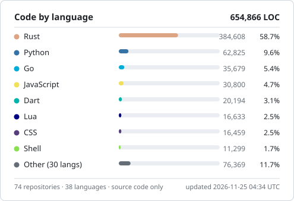

<h1 align="center">Breadway</h1>

  Sixteen, Geraldton, Western Australia. 
  I build Linux desktop software and self-host the infrastructure behind it.

  
  

---

## What I'm building

**[Bread OS](https://github.com/Breadway/bos)** is an Arch-based Linux distribution with a fully scriptable desktop. Everything in its shell is a small, focused app rather than one monolith: a bar, a launcher, a clipboard history, a locker, a control panel, all talking to the same event bus.

**[bread](https://github.com/Breadway/bread)** is the fabric underneath it. A Rust daemon normalises hardware and compositor signals into semantic events, then dispatches them to hot-reloadable Lua modules, so a dock, a monitor layout or a power profile is a short script instead of patched-together shell hooks.

**[Bread ecosystem](https://github.com/Breadway/bread-ecosystem)** is the set of apps around that core: [breadbar](https://github.com/Breadway/breadbar), [breadbox](https://github.com/Breadway/breadbox), [breadclip](https://github.com/Breadway/breadclip), [breadsearch](https://github.com/Breadway/breadsearch), [breadlock](https://github.com/Breadway/breadlock), [breadpad](https://github.com/Breadway/breadpad) and friends. Mostly Rust and GTK4, plus a shared theming layer so they all look like one system.

**[breadboard](https://github.com/Breadway/breadboard)** is a self-hosted issue tracker and kanban board, Rust and SQLite on the server with a Svelte frontend and a TUI and desktop client on top.

**[egress](https://github.com/Breadway/egress)** gets me online from networks that block everything except HTTPS, by tunnelling WireGuard inside TLS through a relay I control.

The rest is a homelab: a build server, a couple of small VPS edges, Caddy and WireGuard at the front, and Forgejo, Jellyfin, Immich and a slow-burn Nextcloud replacement behind it.

## Featured projects

| Project | What it is |
| --- | --- |
| [**bos**](https://github.com/Breadway/bos) | Bread OS: the distro, ISO build and installer |
| [**bread**](https://github.com/Breadway/bread) | Reactive desktop automation daemon with a Lua module API |
| [**breadboard**](https://github.com/Breadway/breadboard) | Self-hosted issue tracker, board and CLI/TUI/Tauri clients |
| [**egress**](https://github.com/Breadway/egress) | Signed WireGuard-over-TLS client for hostile networks |
| [**breadlock**](https://github.com/Breadway/breadlock) | Session locker and greetd greeter for Wayland |
| [**infra**](https://github.com/Breadway/infra) | Homelab specs, compliance checks and deployment automation |

## Stats

  <picture>
    <source media="(prefers-color-scheme: dark)" srcset="assets/languages-dark.svg">
    
  </picture>

  
  

The language card above is generated by this repo, not by a third-party service. A workflow runs nightly, clones every non-fork repository I own, counts lines with [tokei](https://github.com/XAMPPRocky/tokei) and commits the SVG. It includes private projects, so the totals are larger than what GitHub's public language bars show. Prose, JSON, YAML and lockfiles are excluded so the percentages describe source code.

Rebuilt by <a href=".github/workflows/loc.yml">.github/workflows/loc.yml</a>.
